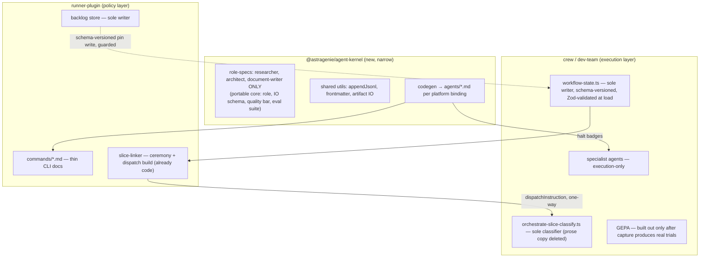

# Architecture Retrospective — runner-plugin + crew (dev-team)

_Date: 2026-07-02 · Method: 8 parallel read-only researchers (WP1–WP8) per
`docs/prompts/2026-07-02-architecture-retrospective-prompt.md` v2, synthesized by the
main thread. Every claim carries file:line or artifact evidence plus a confidence
label (H/M/L) and evidence quality (Strong/Moderate/Weak)._

---

## 0. Synthesis corrections (read first — these change the priors)

Three widely-held beliefs about this system were refuted or corrected during
contradiction-hunting:

1. **"$34.5/iteration" is a measurement artifact, not the real cost.** The snapshot
   averages the top-20 cost reports naively. Removing 2 byte-identical duplicate
   reports drops it to $22.12; removing the FEAT-112/SLICE-115 opus outlier (a
   **docs-only slice** billed $142.95, 84.8% to opus — grade file confirms "no code
   changes, no lint, no test surface") drops it to **$7.03/report**. The two real
   problems are (a) wave-mode cost attribution writing the same session cost under
   each sibling FEAT label, and (b) model-tier routing not consulting slice
   classification. [H/Strong — WP5 §1, pricing model arithmetically verified]

2. **GEPA has never run.** The optimize/eval pipeline (gepa-core + dev-team GEPA
   skills on `origin/main`) is architecturally sound — deterministic held-out
   splits, 5-condition promotion gate, dual-clock soak, critical-agent allowlist —
   but zero trial JSONL exists anywhere in either repo's history (908 commits
   scanned), candidate generation is a stub behind unset `GEPA_LIVE_GENERATOR`,
   and the default judge (`ollama llama3.2`) is a model class the team's own
   `evals/` harness rejected on 2026-06-29. Every "improve GEPA" recommendation is
   downstream of simply turning capture on. [H/Strong — WP3; corroborated by WP1,
   WP4, WP8 independently]
   - Note: the dev-team **local checkout is 223 commits behind `origin/main`** (on
     `docs/multi-profile-review-pipeline`). WP1/WP4/WP5 read the stale tree and
     concluded "GEPA doesn't exist"; WP3 read `origin/main` and found it. Both are
     right about the thing that matters: no production data. The stale checkout is
     itself a finding (F-08).

3. **The specialist-pause epidemic is largely fixed — but the SOP wasn't updated.**
   ~31% of slices in the SLICE-51..98 window had ≥1 pause-without-artifact; after
   FEAT-161's scaffold-first output contract (dev-team, 2026-06-13) and FEAT-191's
   removal of `lead` mode, grade files 108–133 show **zero new occurrences**.
   `docs/sop/specialist-pause-handling.md:37-41` still detects pause by raw file
   existence — which now false-positives on the `status: in-progress` scaffold the
   fix intentionally leaves behind. [H/Strong for mechanism; M for causal
   attribution — WP2 §2–3]

Also corrected: the "2026-06-10 workflow-state corruption" the prompt cites is
real but invisible to repo archaeology — the only record is the `reconcileNote`
field **inside the live `workflow-state.json` itself** (observed directly via
`crew brief-me` this session: "workflow-state rebuilt after a session hang
(FEAT177 SLICE88 marathon, ~117min/85M tokens)... currentRun cleared to null").
No postmortem artifact exists anywhere. That an incident's only trace lives in
the mutable state it corrupted is itself the observability finding (F-13).
[H/Strong — live-state observation + WP1 F5 + WP7]

---

## 1. Top-10 recommendations (ranked by impact ÷ effort)

| # | Title | Type | Effort | Impact (quantified) | Conf | Evidence |
|---|---|---|---|---|---|---|
| 1 | **Fix wave-mode cost attribution + dedup cost reports** — one session's cost is written under each sibling FEAT label; 4 near-duplicate reports for one wave in the top-20 window alone | Quick win | 4–8h | Restores telemetry integrity; headline metric currently inflated ~5×; every cost-based decision (cost-advisor verdicts, stop thresholds) is reading corrupted input | H/Strong | WP5 §1 sink#2; `crew-bridge.mts:53-58`; byte-identical `20260613T092251Z`/`092249Z` reports |
| 2 | **Model-tier routing by slice classification** — docs/trivial slices must not run opus; SLICE-115 (classified `docs`) burned $121 of $143 on opus | Quick win | 4–8h | Single incident = 20× the window's median slice cost; recurs every wave with mixed slice shapes | H/Strong | WP5 sink#1; grade `20260613T092310Z-feat112-slice115-grade.md:25-26` |
| 3 | **Update `specialist-pause-handling.md` SOP to check scaffold `status` field**, not file existence | Quick win | 2–3h | Removes an active false-positive in the safety procedure that exists precisely for the system's worst failure mode | H/Strong | WP2 §3; SOP `:37-41` vs `dev-team/agents/inspector.md:41-52` |
| 4 | **CLAUDE.md drift purge** — delete/fix: `commands/slice-review-ladder.md` (doesn't exist; real impl is `post-builder-fanout.mts`), `multidim` preset (no code), `backlog-enrich.md`/`retriage.md` refs (files absent), stale upstream-request asking to restore `lead` mode that FEAT-191 killed for cause | Quick win | 3–5h | CLAUDE.md is injected into every session; each false pointer costs a wasted search per consultation, and the stale upstream-request invites re-introducing a known failure | H/Strong | WP1 F1, WP2 QW4/QW5, WP5 §3 |
| 5 | **Make loop-snapshot regeneration a blocking gate or auto-regen** — snapshot injected into every agent context is 19 days stale; 2 of its 5 "next to slice" FEATs are already done | Quick win | 3–6h | Prevents agents from routing work at already-shipped FEATs; staleness gate exists but is warn-only | H/Strong | WP7; `loop-snapshot.md:1,15-20` vs live `backlog/done/`; `pre-push-validate.mts:1-11` |
| 6 | **GEPA go-live prerequisites** (in order): enable capture on one low-stakes agent (2–4h); replace default judge with the already-validated groq+gemini triangulation (2–3h); grow held-out sets to ≥5 cases so drift detection stops being structurally inert (4–8h) | Quick win | ~1–2 days total | Unblocks the entire optimization program; without this, all GEPA governance machinery guards nothing | H/Strong | WP3 ranked #1–3; `detect-eval-drift.ts:42-89` vs 2–3 actual held-out cases |
| 7 | **Runtime-validate crew workflow-state + schema-version guard on loop's cross-plugin write** — `WorkflowStateSchema` (Zod) exists but `loadWorkflowState` does raw `JSON.parse` ("shape is trusted"); loop writes into crew's state file with divergence risk DEC-018 itself documents | Quick win | 4–6h | Converts the exact silent-corruption class behind the 2026-06-10 incident into a loud, catchable error | H/Strong | WP7; `dev-team/scripts/lib/workflow-state.ts:117-137` vs `schemas.ts:69-76`; WP1 F4, DEC-018:26-27 |
| 8 | **Delete the prose duplicate of the orchestrate-slice classifier** — 30 lines of tag heuristics in `orchestrate-slice.md:27-56` duplicate `orchestrate-slice-classify.ts`, which the Markdown itself calls "the source of truth" | Quick win | 2–3h | Removes a self-admitted silent-divergence risk with no CI parity check | H/Strong | WP1 F2 |
| 9 | **Prompt-quality batch**: rewrite `devcrew:architect` (99 lines, no budget/examples/fallback); add explicit Observability gate to inspector+verifier (absent while observability is the lowest grade dimension, 0.82); reconcile pm.md `Edit,Write` grant vs its "read-only" boundary; resolve whether `devcrew:loop-discipline`/`authoring-slices` (living outside `skills/**`) actually load — 4 agents cite them as HARD-GATE required | Quick win batch | 1–2 days | Directly targets the weakest measured grade dimension and a possibly-silent no-op contract on every pm/architect/researcher/doc-writer dispatch | M–H/Strong | WP6 verdict table; `agents/pm.md:8` vs `:207`; `.claude/loop/discipline.md:1-4` |
| 10 | **Harden the autonomous loop against prompt injection** — PM reads untrusted FEAT bodies (github-sync ingestion path exists) with Bash/Write/Agent granted and zero injection-defense language; 12/15 dev-team vendored 3rdparty agents carry Bash/Write with no provenance metadata; blast radius = unattended builder dispatch with full tools under `marathonMode` | Structural | 2–4 days | Closes the highest-severity unmitigated threat in a system designed to run unattended | M/Moderate (chain is architecturally sound, not empirically exploited) | WP7 evidence table + call graph; `agents/pm.md:3,8,143`; `github-sync-loader.mts:1-31` |

Deliberately **not** in the top-10 (structural, gated on ADRs below): portable
agent-core extraction (3 roles only — ADR-B), GEPA optimize-target decision
(ADR-C), shared `appendJsonl`/skill-dedup consolidation (F-09/F-10), MCP read-only
surface (WP8, Phase 2).

---

## 2. Subsystem scorecard (WP1; 0–10, higher = better; Confidence: Medium overall)

| Subsystem | Maint. | Coupling | Cohesion | Scal. | Test. | Discov. | Perf. | DX | Op.Simpl. | Extens. |
|---|---|---|---|---|---|---|---|---|---|---|
| Backlog store | 7 | 6 | 7 | 6 | 6 | 6 | 7 | 6 | 6 | 7 |
| Slice ceremony (`slice-linker/*`, 4629 LOC) | 5 | 5 | 6 | 6 | 6 | 5 | 7 | 5 | 6 | 6 |
| Dispatch layer (11 `dispatch-*.mts` + 541-line `orchestrate-slice.md`) | 5 | 4 | 4 | 6 | 5 | 4 | 7 | 5 | 6 | 5 |
| State stores (workflow-state + backlog frontmatter + snapshot) | 6 | 4 | 5 | 5 | 5 | 5 | 7 | 5 | 5 | 5 |
| Agent roster (5+18 owned, 7+15 vendored, zero 3rdparty overlap) | 6 | 6 | 5 | 7 | 6 | 6 | n/a | 5 | 7 | 6 |
| GEPA harness (never run; scaffolding on origin/main only) | 3 | n/a | n/a | n/a | 2 | 2 | n/a | 2 | 8 | 3 |
| Telemetry / cost (1522 LOC + crew cost-advisor) | 6 | 5 | 6 | 6 | 6 | 6 | 7 | 6 | 6 | 6 |
| Config (loop.json ×2, crew.json, presets; gepa config in 3rd repo) | 5 | 5 | 4 | 6 | 5 | 5 | 8 | 4 | 5 | 5 |
| Hooks (RP 4 files vs DT 11+9) | 6 | 6 | 6 | 7 | 5 | 5 | 7 | 5 | 6 | 6 |
| Docs (CLAUDE.md + snapshot + docs/**) | 5 | n/a | 6 | 7 | n/a | 5 | n/a | 6 | 5 | 6 |

Weakest rows: **dispatch layer** (prose/code duplication, fragmentation),
**state stores** (cross-plugin write, no runtime validation), **GEPA** (doesn't
run), **config** (3-repo sprawl, no shared validator), **docs** (verified stale
pointers in the always-injected files).

---

## 3. Architecture: what we'd do differently, and the 18–24-month vision

### 3.1 What's already right (contradiction-hunting results — don't touch)

- **Dependency direction runner→crew is strictly one-way** at source level (zero
  reverse references outside runtime artifacts). No shared-kernel package is
  justified for the plugin dependency itself. [H/Strong — WP1]
- **The dual state-store is a documented, deliberate tradeoff** (DEC-018/DEC-019:
  session-pin correctness bought at an accepted, mitigated divergence risk).
  Unification rejected; add the schema-version guard (top-10 #7) instead. [H/Strong]
- **runner-plugin already moved dispatch orchestration into testable code**
  (`slice-linker/dispatch.mts` builds `dispatchInstruction`; commands/*.md are
  mostly thin CLI docs). The "orchestration lives in Markdown" hypothesis holds
  for dev-team's `orchestrate-slice.md` (541 lines, 5 embedded prompt blocks),
  not for runner-plugin. [H/Strong — WP1, WP2]
- **The scaffold-first artifact handshake is load-bearing platform binding**, not
  a naive design — it exists specifically to survive Claude Code's mid-run-pause
  failure mode and demonstrably ended the pause epidemic. [H/Strong — WP2, WP4]

### 3.2 Greenfield sketch (evolutionary target, WP1 + WP4)

Key from-scratch decisions: (1) shared kernel holds **only** the 3
confirmed-duplicate roles + mechanical utils — the other 20 owned agents have no
cross-plugin counterpart (YAGNI); (2) tier routing becomes data (capability→tier
matrix) owned by the binding layer — today model is a hardcoded frontmatter
literal, and the two `architect` agents already drift (dev-team pins opus,
runner-plugin has **no `model:` field at all**); (3) every prose copy of code
logic dies.

### 3.3 18–24-month vision (WP8 — Confidence: Low-Medium by construction)

The target shape already has validated internal precedents: `gepa-core` (pure-ESM,
multi-provider, zero Claude-Code deps) is the model-abstraction pattern;
`astramem-plugin` → AstraMemory (thin client + bounded local queue + multi-tenant
.NET service with API-key/TenantContext/RBAC) is the cloud-split pattern;
AstraRunner shows the cloud control plane is already underway one repo over.

- **MCP strategy**: expose **read-only, stateless** surfaces first (backlog query,
  snapshot/telemetry, grade history). The slice-ceremony write path stays
  plugin-only — DEC-011 already rejected headless orchestration once, and the
  `sessionDrift` halt-badge exists because cross-session writes corrupt state.
- **Ecosystem/governance**: `astra-marketplace` is an empty stub and
  `docs/upstream-requests/` is the only RFC process (7 open, ≥1 stale). A
  third-party agent SDK needs manifest schema + provenance metadata + security
  review gate — this is the same problem as the 3rdparty supply-chain finding
  (top-10 #10), solved once.
- **First three irreversible decisions**: (1) portable agent-spec schema shape —
  before tier-routing metadata lands in it; (2) MCP read-only vs write boundary —
  gated on the DEC-011 rationale; (3) tenancy/auth model for any cloud control
  plane — copy AstraMemory's shape or decide deliberately not to, before any
  customer-facing endpoint ships.

---

## 4. Consolidated findings register

Format: `[SEV] claim — evidence — root cause — fix — hours — improvement — confidence`.
Full per-WP detail lives in the researcher outputs; this register is the
deduplicated union.

**Cost & performance (WP5)**
- **[HIGH] F-01** Wave-mode cost double-counting — byte-identical reports
  `feat180-slice115`/`feat165-slice115` ($3.846 each), opus triplicate ~$142.8×3 —
  per-FEAT report emission attributes shared session cost to each sibling —
  split or dedup at emission (`crew-bridge.mts:53-58`, wave path) — 4–8h —
  telemetry integrity + honest cost-advisor input — H/Strong.
- **[HIGH] F-02** Opus on docs slice — SLICE-115 $121 opus on `shape: docs` —
  wave dispatch doesn't consult slice classification for model tier — tier-route
  by classification before dispatch — 4–8h — eliminates 20×-median outliers —
  H/Strong.
- **[MED] F-03** Cache-read is ~55% of window dollars ($153.9/$277.6); 7.05 avg
  redundant reads and 2.45 compactions per report; the `redundant-read-stop`
  feature **exists and is disabled** (`dev-team/.claude/crew.json:3`, rationale
  undocumented) — investigate why, then enable or record a DEC — 2–4h
  investigation — M/Moderate.

**Reliability & dispatch (WP2)**
- **[HIGH] F-04** SOP false-positive on scaffold artifacts (top-10 #3) — H/Strong.
- **[MED] F-05** Dispatch prompts don't restate tool budgets — the SLICE-83 lesson
  ("≤15-tool retry fixed a 53-call stuck reviewer in 6 tools/47s") was landed in
  agent files (50-tool ceiling) but not at dispatch time; tier the budget by slice
  size in `orchestrate-slice.md:395-443` + `dispatch.mts` prompt strings — 3–4h —
  ~5–10% token/latency on review gates — M/Moderate.
- **[MED] F-06** No structured pause/retry counter exists — all pause data is
  prose in grade files (`auto-dispatch.jsonl` measures a different, mostly-dead
  subsystem) — add a JSONL pause-event appender to the SOP detection step — 3–5h —
  makes reliability claims measurable — H/Strong (gap), M (design).
- **[LOW] F-07** `closeTail` mandate string duplicated within `dispatch.mts`
  (built as function at `:119`, re-typed inline at `:187`) — extract — 1h — H/Strong.

**State, docs & hygiene (WP1, WP7, WP5)**
- **[HIGH] F-08** dev-team checkout 223 commits behind origin/main — any analysis
  or agent working in that tree reads a month-old world — sync it; add a staleness
  check to crew brief — 0.5h — H/Strong.
- **[MED] F-09** 8 hand-rolled JSONL-append implementations inside runner-plugin
  alone (`auto-dispatch.mts:63-93`, `dispatch-trace.mts:38-42`, `learnings.mts:82`,
  5 more) with divergent error/batching semantics — one `appendJsonl` helper —
  3–4h — H/Strong.
- **[MED] F-10** 12 of 15 runner-plugin skills share identical path+name with
  dev-team copies; 11 have silently diverged (8–46 diff lines) — fixes don't
  propagate; live bit-rot — pick sync strategy (upstream mirror per the existing
  Astragenie.Standards pattern, or CI parity check) — 4–8h — H/Strong.
- **[MED] F-11** Slash-command prose has zero contract tests; frontmatter validator
  checks shape only; `buildDispatchInstruction` tests assert regex prefixes, not
  full text — add golden dispatch-instruction snapshots — 4–8h — H/Strong (gap).
- **[MED] F-12** Config sprawl is 3-repo (loop.json ×2 schemas' worth, crew.json,
  gepa config in gepa-core), no shared validator; merging rejected (different
  authority domains) — add one JSON-schema validator invoked by both pre-push
  hooks — 4–6h — M/Moderate.
- **[MED] F-13** No end-to-end slice trace — dispatch/artifacts/grade/cost live in
  ≥8 directories across two artifact roots; no `loop.mts trace <slice>` verb; the
  06-10 incident's only record is inside mutable state — add a read-only trace
  subcommand joining by slice ID — 1–2d — M/Moderate.

**Prompts & evals (WP6, WP3)** — see top-10 #6 and #9; plus:
- **[MED] F-14** Inspector eval corpus is mined from the inspector's own past
  reviews — measures reproduction, not generalization; auto-grow gated on the same
  judge being evaluated (self-referential bias risk) — add independently-authored
  novel bug-class cases + human spot-check gate on corpus growth — 6–10h +
  12–20h — M/Moderate.
- **[MED] F-15** Dev prompts: 269/367 lines byte-identical between backend-dev and
  frontend-dev — extract shared "builder discipline" blocks (route through GEPA
  once evals are live, per the prompt's own rule) — 1–2d — H/Strong (measurement).

**Security (WP7)** — see top-10 #10; components: PM tool-grant/boundary
contradiction (`pm.md:8` vs `:207`), no injection-defense language in any owned
agent, 3rdparty provenance absence, `autonomous_safe` unattended chain.

---

## 5. ADR drafts (structural recommendations only)

### ADR-A: Wave-mode cost attribution
- **Context**: Per-FEAT cost reports inside a wave each record the full shared
  session cost (F-01); rolling averages and cost-advisor verdicts consume them.
- **Decision**: One cost report per session/worktree; sibling FEATs reference it
  with a proportional-split or `shared_with:` field. Snapshot averages dedup by
  session ID.
- **Alternatives**: (a) status quo + dedup only at read time (leaves artifacts
  wrong on disk); (b) split evenly per FEAT (loses truth of shared context).
- **Consequences**: Historical reports remain inflated — annotate window or
  backfill; consumers (`memory-snapshot.mts:45-83`, cost-advisor) need one field.
- **Migration**: emission fix → snapshot dedup → optional backfill script.
  **Rollback**: revert emission; read-side dedup is harmless to keep.

### ADR-B: Portable agent core, narrow scope
- **Context**: 3 roles duplicated cross-plugin with divergent schemas (WP1 F7);
  full YAML→codegen abstraction rejected for now (WP4 anti-purity verdict: zero
  GEPA data to protect, `capabilities:` block proves additive extraction works).
- **Decision**: Extract IO contracts + quality bars for researcher/architect/
  document-writer into shared reference docs (kernel package later, only if a
  second platform binding materializes). Model tier becomes data
  (capability→tier matrix); fix the runner-plugin architect missing `model:` now.
- **Alternatives**: full codegen pipeline (rejected: YAGNI, no consumer);
  status quo (rejected: 3× drift is measured, not hypothetical).
- **Consequences**: agent .md files reference shared docs; validate-agents gate
  extended to check reference freshness.
- **Migration**: one role (researcher) first. **Rollback**: inline the shared doc
  back; no runtime dependency.

### ADR-C: GEPA optimization target
- **Context**: `Candidate` schema keys on whole-file `prompt_path`/`prompt_hash`;
  optimizing the rendered artifact bakes Claude-Code phrasing into fitness-selected
  text. Zero trial history exists — the decision is free **today** and expensive
  after data accumulates.
- **Decision**: GEPA optimizes an addressable portable-core block within the
  prompt file; platform binding is re-rendered per candidate. Record this before
  `GEPA_LIVE_GENERATOR` is ever enabled.
- **Alternatives**: whole-file optimization (cheaper now, lock-in later).
- **Consequences**: candidate generator needs block-extraction; judges score the
  core, not tool wiring.
- **Migration**: schema field `target_block` + generator change, before go-live.
  **Rollback**: trivial pre-data; painful post-data (that asymmetry is the reason
  to decide now).

### ADR-D: Cross-plugin state write contract
- **Context**: loop writes session pins into crew's `workflow-state.json`
  (DEC-018/019, deliberate); crew loads it without validating (WP7); one silent
  rebuild incident on 2026-06-10.
- **Decision**: crew validates with existing `WorkflowStateSchema` at load
  (fail loud, offer `--repair`); the file gains `schemaVersion`; loop refuses to
  write on version mismatch.
- **Alternatives**: unify stores (rejected — WP1 §e1); status quo (rejected —
  incident happened, only record is in the state file itself).
- **Consequences**: version bump discipline joins `MIN_CREW_VERSION` in the
  cross-plugin contract surface.
- **Migration**: additive field + guard; old files get version 1 implicitly.
  **Rollback**: remove guard; validation stays (pure win).

---

## 6. Intake-ready FEAT stubs (quick wins)

1. **FEAT: Wave-mode cost report deduplication** — Emit one cost report per
   session; sibling FEATs reference, not copy. Fix snapshot averaging to dedup.
   AC: re-running the SLICE-115 wave shape yields 1 report + N references; snapshot
   average excludes duplicates. _P1, autonomous_safe: true_ (telemetry-only).
2. **FEAT: Slice-shape-aware model tier routing** — `docs`/trivial classified
   slices dispatch on the small/mid tier; wave planner consults classification
   before worktree dispatch. AC: docs slice dispatch prompt contains no opus
   routing; regression test on SLICE-115 fixture. _P1, autonomous_safe: true_.
3. **FEAT: SOP scaffold-status pause detection** — Update
   `specialist-pause-handling.md` to distinguish `status: in-progress` scaffold
   from completed artifact; cite FEAT-161. AC: SOP walk on a scaffold-only run
   classifies as pause, not success. _P1, autonomous_safe: true_ (docs).
4. **FEAT: CLAUDE.md drift purge** — Remove/replace: slice-review-ladder.md
   pointer, multidim preset section (or implement), backlog-enrich/retriage file
   refs; close stale lead-restoration upstream-request. AC: every file path in
   CLAUDE.md resolves; `status: open` upstream-requests reflect current intent.
   _P1, autonomous_safe: true_.
5. **FEAT: Blocking snapshot staleness gate** — `--check-generated` fails CI (or
   auto-regens) when snapshot is older than newest grade/backlog change. AC: CI
   red on stale snapshot fixture. _P2, autonomous_safe: true_.
6. **FEAT: Zod-validate workflow-state at load + schemaVersion guard** (ADR-D
   implementation, crew-side + loop-side). AC: malformed state file produces a
   named error with repair hint, not a JSON.parse throw. _P1, autonomous_safe:
   true_ with review.
7. **FEAT: GEPA capture canary** — enable capture for one agent; judge default →
   groq+gemini; held-out sets ≥5/agent. AC: ≥1 real trial row lands under
   `crew/gepa/trials/`; drift detection numerically active. _P2,
   autonomous_safe: false_ (touches optimization governance).
8. **FEAT: Shared appendJsonl helper** — replace 8 hand-rolled appenders. AC: one
   helper, 8 call sites migrated, behavior-equivalence tests. _P2,
   autonomous_safe: true_.
9. **FEAT: Structured pause/retry telemetry** — JSONL event per detected pause.
   AC: pause events queryable; brief renders a rate. _P2, autonomous_safe: true_.
10. **FEAT: Injection-defense preamble + PM tool-grant reconciliation** — treat
    FEAT bodies/web artifacts as data in pm/architect/dev prompts; drop PM's
    unused grants or document why they're needed. AC: injection canary FEAT body
    does not alter PM scoring behavior in eval. _P1, autonomous_safe: false_.

---

## 7. 90-day roadmap

**Week 1 (integrity of the instruments)** — FEATs 1, 2, 3, 4, 5 + F-08 checkout
sync. Everything later is measured through these instruments; fix them first.
All parallelizable; no dependencies.

**Week 2 (reliability)** — FEAT 6 (ADR-D), FEAT 9, F-05 dispatch-time budgets,
F-07 dedupe. Depends on Week 1 only for honest before/after measurement.

**Weeks 3–4 (evals live + prompts)** — FEAT 7 (GEPA canary; **ADR-C must be
recorded before `GEPA_LIVE_GENERATOR` is considered**), top-10 #9 prompt batch
(architect rewrite, observability gates, skill-packaging resolution). The prompt
batch intentionally lands while GEPA capture accumulates baseline data on the
*old* prompts — that contrast is the first real eval signal.

**Month 2 (consolidation)** — FEAT 8, F-10 skill-sync strategy, F-11 golden
dispatch snapshots, F-12 config validator, F-13 slice trace verb. ADR-B pilot:
researcher role extraction. Critical path: golden snapshots before any dispatch-
prompt refactor (they're the safety net for it).

**Month 3 (security + structure)** — FEAT 10 full threat-model pass (needs
Month-2 provenance/manifest groundwork for 3rdparty agents), F-15 dev-prompt
dedup routed through now-live GEPA evals, first rubric-vs-grade correlation
check (WP3 #6). Gate review: decide whether ADR-B graduates to a kernel package
(only if a second platform binding is actually planned — otherwise stop).

Parallel tracks throughout: quick wins are independent; the dependency spine is
Week1 telemetry → Week3 GEPA baseline → Month3 GEPA-routed prompt work.

---

## 8. Explicitly rejected ideas

1. **State-store unification** — DEC-018/019 document the dual-write as a
   deliberate, mitigated tradeoff; no incident traced to the accepted risk class
   (the 06-10 rebuild was a session hang, and ADR-D addresses detection). Cost of
   cross-plugin migration outweighs a theoretical purity gain. [WP1 §e1]
2. **Shared kernel for the runner→crew plugin dependency** — dependency direction
   is already correctly one-way; nothing to untangle. [WP1 §e2]
3. **Full agent-roster merge** — zero 3rdparty filename overlap; 20 of 23 owned
   agents have no cross-plugin counterpart; forced abstraction is YAGNI. [WP1 §e3]
4. **YAML→codegen agent pipeline now** — no GEPA trial data to protect from
   lock-in, no second platform binding exists, the `capabilities:` precedent shows
   additive extraction works without codegen. Revisit at Month-3 gate. [WP4]
5. **Consolidating the 11-file `dispatch-*.mts` cluster** — fragmentation without
   a measured symptom; no correctness or discoverability incident tied to it.
   Optional cleanup only. [WP1 §e4]
6. **Merging loop.json + crew.json** — different authority domains (methodology
   vs specialist runtime); shared validator yes, shared file no. [WP5 §4]
7. **Codegen-generating the orchestrate-slice prose table** — the doc already
   treats its own prose as advisory; deletion is cheaper and truer to usage than
   a sync pipeline. [WP1 §e6]
8. **Re-opening `completeSlice` workflow-state re-reads as a quick win** —
   already fixed (single read + `cachedWorkflowState` threading, matching the
   2026-06-08 IO design doc). [WP1 F3]
9. **Restoring `lead` orchestrator mode** (as the stale upstream-request asks) —
   killed for documented cause across 7 slices; the scaffold contract now covers
   the underlying failure mode; reintroduction needs new evidence, not nostalgia.
   [WP2]

---

## 9. Prior-analysis reconciliation

`dev-team/crew-architecture-analysis.md` and `crew-optimization.md` exist only on
the stale local branch (not on `origin/main`), which is why the git-history scan
missed them. Where read (WP1): the crew-optimization pass introduced the
model/effort/maxTurns agent frontmatter schema that runner-plugin never adopted —
this retrospective's ADR-B extends that work rather than repeating it; the
schema divergence it created is F7's root cause and is now explicitly owned.
No claim in either prior document was found to contradict this report's findings.

## 10. Definition-of-done check

- ✅ Report at `docs/research/2026-07-02-architecture-retrospective.md`
- ✅ Top-10 items: evidence + confidence + quantified impact
- ✅ Subsystem scorecard (10×10)
- ✅ ADR drafts for every structural rec (A–D)
- ✅ 10 intake-ready FEAT stubs (≥5 quick wins)
- ✅ 90-day roadmap with critical path
- ✅ Prior analyses cited/reconciled; refuted prompt-premises listed in §0
